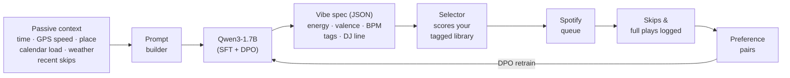

# Auxie

### The DJ that reads the room, then learns from every skip.

**Auxie picks the right song for the moment you're in, without you asking.** It reads passive context (time, place, speed, calendar, weather, what you just skipped) and queues music on your real Spotify. A small open model that we fine-tuned makes each decision, and it is designed to keep improving from your behavior.

🏆 **Special Recognition, veri.studio Open-Source Model Track, LA Hacks 2026**

[▶ Demo video](https://www.youtube.com/watch?v=dbpUjdWtQZw) · [Devpost](https://devpost.com/software/auxie) · Model weights: [aux-sft](https://huggingface.co/ssabesan9009/aux-sft) · [aux-dpo](https://huggingface.co/ssabesan9009/aux-dpo)

---

## The problem

Streaming apps know what you like, but not **what you need right now**. The same person wants different music walking to a midterm, driving the freeway at night or winding down after five back-to-back meetings. Today the listener does that translation by hand: searching, skipping, switching playlists.

Two things make this hard to fix with a big AI model:
- **The signals are private.** Location, calendar and listening history are about as sensitive as personal data gets.
- **Decisions are constant.** A DJ chooses every few minutes, all day, so cloud-API cost and latency add up fast.

## The approach

Auxie runs on **Qwen3-1.7B, a small open model** we fine-tuned to do one job well. It is small enough to run on a laptop and costs a fraction of a frontier API per call.

| | |
|---|---|
| 🔒 **Private by design** | A 1.7B model can run on-device, so personal context never has to leave your machine |
| ⚡ **Fast and cheap** | ~1.7× lower latency than the frontier teacher model; under $1 of GPU time per training run |
| 🎯 **Personal, not generic** | In our A/B tests the listener **disagreed with the frontier model 54% of the time**, so a one-size-fits-all model leaves value on the table |
| 🔁 **Self-improving loop** | Every skip becomes a training signal for the next model version |

## How it works



A real example from the training data, showing what the model sees and what it returns:

```
Fri 02:10 PM (afternoon) | Geisel library, still, 0 mph, arrived 2 min ago
55F fog
today: 3 events, 3 back-to-back, last ended 110 min ago | current: "lunch w/ Priya" | next: "study session w/ Jamie" in 10 min
recent: skipped 3 in a row (sad, nostalgic)
```
```json
{"energy": 0.4, "valence": 0.6, "bpm_min": 72, "bpm_max": 88,
 "tags": ["lo-fi", "focus", "chill"], "dj_line": "foggy afternoon vibes to ease you into study mode"}
```

## Training pipeline

We **distilled** a frontier model's judgment into a small model, then **personalized** it with human preference data.

| Stage | What we did | Code |
|---|---|---|
| 1. Synthetic contexts | Generated 999 realistic day-in-the-life scenarios | `scripts/gen_contexts.py` |
| 2. Teacher labels | Claude Sonnet wrote the ideal vibe spec for each | `scripts/label_teacher.py` |
| 3. **SFT** | Qwen3-1.7B, LoRA r=16, 2 epochs, 899 train / 99 held out, 1× L4 GPU, **$0.58** | `configs/sft.toml` |
| 4. A/B pairs | 250 contexts, each with the teacher's pick vs a deliberately different one, both mapped to real tracks | `scripts/gen_pairs.py` |
| 5. Human labels | Listener heard both tracks in a built-in labelling UI and chose; **198 usable labels** | `app/main.py` (`/label`) |
| 6. **DPO** | 158 train / 40 held out, LoRA r=16, β=0.1, 2 epochs, **$0.41** | `configs/dpo.toml` |
| 7. Continual learning | Pipeline that turns real skips of Auxie's own picks into new DPO pairs | `scripts/skips_to_pairs.py` |

## Results

Held-out evaluation: 50 SFT rows and 40 human-labelled preference rows ([full log](results/runs.md) · [raw metrics](results/metrics.json)).

| Model | Valid JSON | Error vs teacher (energy / valence / BPM) | Latency p50 / p95 |
|---|---|---|---|
| Teacher: Claude Sonnet (API) | 100% | — | 1.88 s / 2.28 s |
| **aux-sft** (Qwen3-1.7B) | **100%** | 0.087 / 0.048 / 8.6 | **1.12 s / 1.23 s** |
| **aux-dpo** (Qwen3-1.7B) | **100%** | **0.075 / 0.041 / 8.3** | **1.12 s / 1.17 s** |

**What we showed**
- A 1.7B open model reproduces a frontier model's structured output with **100% valid JSON**, **~1.7× faster**, for **under $1** of training compute.
- DPO moved the model measurably closer to the target than SFT alone (energy error −14%, valence −15%).

**What we learned**
- On matching the listener's own A/B picks, every model, including the frontier teacher, scored 45%. A stronger DPO run (β=0.3, 4 epochs) didn't move it either. Row-by-row checks showed why: our preference pairs contrasted the teacher's pick with an artificially shifted one, which teaches *"don't be wrong"* more than *"be like me."*
- That points to the real moat: **behavioral data from real use.** The skip-to-preference pipeline is built and tested; it needs live listening sessions to feed it.

**Engineering note:** Qwen3's default "thinking mode" wrapped answers in `<think>` tags, and 89 of 90 raw calls failed parsing. We caught it in eval and disabled it per request, before it could break the live demo.

## Roadmap

- **Round 2 on real skips**, measuring whether the model can beat the frontier teacher at predicting one person's taste
- **On-device inference** (e.g. via Ollama), so no context leaves the phone or laptop
- **Richer passive signals:** activity, heart rate, screen time
- **Spoken DJ intros** generated from the model's `dj_line`
- **Per-user adapters:** one small LoRA per listener on a shared base model

## Built with

`Qwen3-1.7B` · `LoRA` · `SFT` · `DPO (TRL)` · `Veri` (training and serving) · `Hugging Face` · `Claude Sonnet` (teacher) · `FastAPI` · `Pydantic` · `Spotify Web API` · `Open-Meteo` · `iCal`

## Repository structure

```
app/            FastAPI app: Spotify OAuth, context builder, model client, selector, DJ loop, A/B labelling UI
scripts/        Context generation, teacher labelling, pair building, DPO conversion, eval, skip-to-pair loop
configs/        SFT, DPO and deployment configs
data/           Synthetic contexts, SFT/DPO datasets, A/B labels, track catalog, demo replay traces
results/        Eval metrics and the training/deployment log
docs/PRD.md     Product spec written during the hackathon
```

## Run it

You need Python 3.10+, a Spotify Premium account with a [developer app](https://developer.spotify.com/dashboard) (redirect URI `http://127.0.0.1:8000/callback`) and an Anthropic API key.

```bash
pip install -r requirements.txt
cp .env.example .env          # add SPOTIFY_CLIENT_ID and ANTHROPIC_API_KEY
python scripts/build_catalog.py
uvicorn app.main:app --port 8000
```

Open `http://127.0.0.1:8000`, log in with Spotify, start playback on any device and press start. To use the fine-tuned model instead of the teacher, set `MODEL=veri` with `VERI_API_KEY` and `VERI_DEP_ID`. Replay mode runs a recorded day (`data/demo/*.json`) at 4× speed.

## Team

**[Aston Martini-Facio](https://github.com/astonmartinifacio)** and **Sharana Sabesan**, built at LA Hacks 2026.
